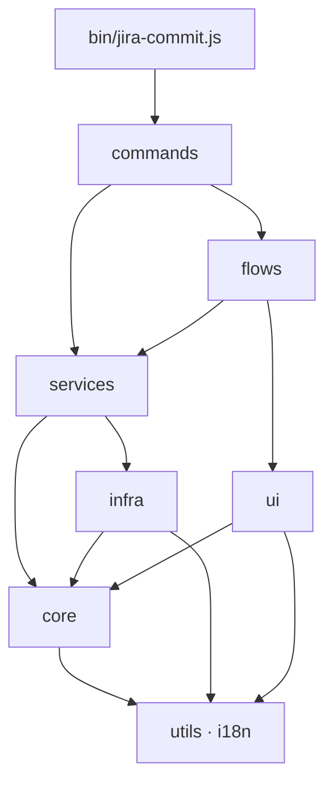
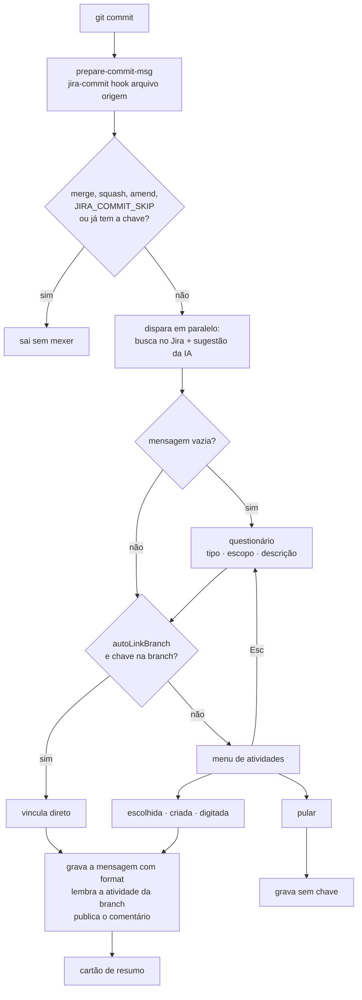

# 🏗️ Arquitetura

Para quem mantém a CLI: como o código está organizado, como os fluxos funcionam, por que as
decisões foram tomadas e como contribuir sem quebrar nada.

| | |
| --- | --- |
| **Entender** | [1. Visão geral](#1-visão-geral) · [2. Camadas](#2-camadas) · [3. Mapa de arquivos](#3-mapa-de-arquivos) · [4. Fluxos](#4-fluxos) |
| **Integrações** | [5. Jira Cloud e Server](#5-jira-cloud-e-server) · [6. Mecanismos internos](#6-mecanismos-internos) |
| **Por quê** | [7. Decisões](#7-decisões) · [8. Limitações conhecidas](#8-limitações-conhecidas) |
| **Fazer** | [9. Como contribuir](#9-como-contribuir) · [10. Rodar e testar](#10-rodar-e-testar) · [11. Lançar uma versão](#11-lançar-uma-versão) |

---

## 1. Visão geral

CLI em **Node.js 22+**, com ES modules e **três dependências**:

| Dependência | Uso |
| --- | --- |
| `@inquirer/prompts` | Perguntas prontas: `select`, `input`, `confirm`, `password`, `search` |
| `@inquirer/core` | Base do prompt próprio do menu de atividades (`ui/search-select.js`) |
| `@anthropic-ai/sdk` | Sugestões por IA. Importado com `import()` **só quando a IA está ligada** |

Todo o resto vem da biblioteca do Node: `fetch` para o Jira, `child_process` para o git e
o gerenciador de pacotes, `util.styleText` para as cores e `node:test` para os testes.

**Princípios:**

- **O commit nunca fica refém da CLI.** Jira fora do ar, IA lenta, sprint que não move, CLI não
  instalada: tudo isso vira aviso, e o commit segue. Só um erro ao **criar** a atividade cancela
  o commit.
- **Rápido.** A busca no Jira e a IA começam no início do hook e rodam enquanto a pessoa responde.
- **Agnóstico.** Funciona com Node ou sem, com Jira Cloud ou Server, em português ou inglês, e
  com vários Jiras.

## 2. Camadas

Cada camada só importa das camadas **abaixo** dela:



| Camada | Responsabilidade | Pode ter I/O? | Testada por |
| --- | --- | --- | --- |
| **`commands/`** | Um arquivo por subcomando. Só orquestra | Sim | Teste manual |
| **`flows/`** | As conversas com a pessoa: menus e perguntas | Sim (terminal) | Simulação de teclado |
| **`services/`** | Casos de uso sem interação (montar a busca, épicos, diagnóstico) | Sim | Teste manual |
| **`ui/`** | Aparência: tema, prompts, spinner, cartão. Não conhece Jira nem git | Só terminal | `core.test.js` |
| **`infra/`** | Fala com o mundo de fora: Jira, git, IA, arquivos | Sim | `infra.test.js`, `jira.test.js` |
| **`core/`** | Regras puras, sem rede, disco nem terminal | **Não** | `core.test.js` |
| **`utils/`, `i18n/`** | Ferramentas genéricas e todos os textos | Não | `core.test.js`, `i18n.test.js` |

> [!IMPORTANT]
> Regra de bolso: **se dá para testar sem rede, disco nem terminal, vai para o `core/`**, com
> teste.

## 3. Mapa de arquivos

<details open>
<summary><b>Árvore completa</b></summary>

```text
jira-commit-cli/
├─ bin/jira-commit.js          Entrada: escolhe o subcomando, mostra a ajuda, trata erros e Ctrl+C
├─ src/
│  ├─ commands/
│  │  ├─ hook.js              Chamado pelo git: questionário → menu → grava a mensagem → cartão
│  │  ├─ init.js              .jira-commit.json, Husky ou .githooks, hook e npm run commit
│  │  ├─ login.js             Detecta Cloud/Server, testa a conexão e só então salva o site
│  │  ├─ list.js              Lista as suas atividades em árvore
│  │  ├─ comment.js           Comenta numa atividade fora do commit
│  │  └─ doctor.js            Mostra o diagnóstico e sai com 1 se houver erro
│  ├─ flows/
│  │  ├─ choose-issue.js      Menu de atividades: lista, busca, ações
│  │  ├─ pick-issue.js        Escolha simples de atividade (usada pelo comment)
│  │  ├─ create-issue.js      Criação de tarefa ou subtarefa, como uma lista de passos
│  │  ├─ issue-fields.js      Perguntas da criação: tipo, pai, épico, story points
│  │  ├─ after-create.js      Sprint ativa e status inicial (falhas só avisam)
│  │  ├─ commit-questions.js  Tipo, escopo, descrição, corpo e BREAKING CHANGE
│  │  ├─ manual-key.js        Digitar a chave, conferida no Jira
│  │  └─ comment.js           Pergunta e publica o comentário
│  ├─ services/
│  │  ├─ issues.js            JQL das suas atividades (status por ID), busca no projeto, épicos
│  │  ├─ project.js           openProject(): idioma, .jira-commit.json e Jira do repositório
│  │  └─ doctor.js            As verificações do doctor
│  ├─ core/
│  │  ├─ commit-message.js    Separar tipo/assunto, corpo, format, chave digitada
│  │  ├─ commit-options.js    Seção "commit", tipos padrão e importação do cz
│  │  ├─ issue-title.js       Prefixo do produto e maiúscula do título
│  │  ├─ issue-tree.js        Agrupa subtarefas sob o pai
│  │  ├─ issue-match.js       Filtro local, sem acento
│  │  ├─ jql.js               JQL das suas atividades e da busca no projeto
│  │  ├─ validate.js          Valida um valor contra o JSON Schema
│  │  ├─ hook-script.js       Bloco do jira-commit no hook: inclui, atualiza, tira o cz
│  │  ├─ document.js          Parágrafos do corpo e do comentário
│  │  ├─ adf.js               Texto no formato do Jira Cloud (ADF)
│  │  └─ wiki.js              Texto no formato do Jira Server (wiki markup)
│  ├─ infra/
│  │  ├─ jira/client.js       Site atual, autenticação, timeout, JiraError com o status HTTP
│  │  ├─ jira/api.js          Todas as chamadas ao Jira, escritas uma vez
│  │  ├─ jira/dialects.js     O que muda entre Cloud e Server
│  │  ├─ storage/             credentials.js (vários Jiras), project-config.js, repo-state.js, paths.js
│  │  ├─ git.js               Raiz, branch, stage, diff, commits recentes, core.hooksPath
│  │  ├─ git-hook.js          Lê e grava o prepare-commit-msg na pasta certa
│  │  ├─ package-json.js      Lê o package.json e grava scripts sem mudar a formatação
│  │  ├─ package-manager.js   Detecta npm/yarn/pnpm, instala e roda binários
│  │  ├─ commit-tooling.js    .cz-config.js e commitlint do projeto
│  │  ├─ path-lookup.js       Acha a CLI global no PATH (usado pelo doctor)
│  │  ├─ message-file.js      O arquivo da mensagem que o git passa ao hook
│  │  └─ ai.js                Sugestões de título e de descrição (nunca lança erro)
│  ├─ ui/
│  │  ├─ index.js             Ponto único de import da camada
│  │  ├─ theme.js             Cores, ícones, selos, cor de cada tipo de commit
│  │  ├─ prompts.js           Prompts com o tema, separadores, campo de texto longo
│  │  ├─ back.js              Esc em qualquer prompt com back: true devolve BACK
│  │  ├─ search-select.js     Prompt do menu: filtro local na hora + busca remota
│  │  ├─ issue-lines.js       Desenha a árvore de atividades
│  │  ├─ issue-choices.js     A árvore como opções de menu
│  │  ├─ output.js            log, cabeçalho, cartão e corte de texto que mantém as cores
│  │  ├─ spinner.js           Spinner colorido
│  │  └─ summary-card.js      Cartão final do hook
│  ├─ i18n/                   index.js (t, setLanguage, detectLanguage), pt.js, en.js
│  ├─ utils/                  text.js, promise.js (inBackground), steps.js (runSteps, BACK)
│  └─ version.js              Versão, nome e repositório, lidos do package.json
├─ schema/jira-commit.schema.json   Regras do .jira-commit.json (validação e autocomplete)
├─ test/                      core, infra, jira e i18n (node:test)
├─ .github/workflows/test.yml CI: npm test em Node 22 e 24, Ubuntu e Windows
└─ docs/
```

</details>

## 4. Fluxos

### O hook



Dentro do menu, **¶ corpo**, **❝ comentário** e **⋯ outros status** voltam para o próprio menu.
**+ Criar** e **✎ Digitar a chave** podem voltar com Esc ou terminar com uma atividade.

### Criar atividade

`flows/create-issue.js` é uma lista de passos para o `runSteps()`
([seção 6](#perguntas-com-voltar-runsteps)):

| Passo | Quando aparece | De onde vêm os dados |
| --- | --- | --- |
| `kind` | Sempre | — |
| `parent` | Subtarefa | `chooseParent()` + `getIssue()` (labels e componentes) |
| `epic` | Tarefa, se o projeto tiver épicos | `loadEpics()`, disparado antes da primeira pergunta |
| `summary` | Sempre | Prefixo do produto + sugestão da IA (em cache por pai) |
| `storyPoints` | Se o tipo tiver o campo | `storyPointsField()`, buscado em paralelo |
| confirmação | Sempre | "Não" volta ao menu com `exit(BACK)` |

Depois: `createIssue()` → `setRepoState()` → `moveToSprint()` (só tarefa) → status inicial.
Tudo depois do `createIssue()` é tolerante a falhas.

## 5. Jira Cloud e Server

O `api.js` é escrito **uma vez**. O que muda entre os dois tipos de Jira fica no `dialects.js`,
escolhido pelo `type` do site:

| Ponto | Cloud | Server / Data Center |
| --- | --- | --- |
| Autenticação | `Basic base64(email:token)` | `Bearer <token pessoal>` |
| Base da API | `/rest/api/3` | `/rest/api/2` |
| Busca | `GET /search/jql` | `GET /search` |
| Responsável | `{ accountId }` | `{ name }` |
| Descrição e comentário | ADF (`core/adf.js`) | wiki markup (`core/wiki.js`) |
| Tipo épico | `hierarchyLevel` 1 | nome `Epic` / `Épico` |
| Tarefa no épico | campo `parent` | campo "Epic Link", achado em `/field` pelo `schema.custom` |

O tipo é descoberto no `login` por `GET /rest/api/2/serverInfo`, que é público nos dois.

### Chamadas usadas

Caminhos do Cloud. No Server, troque `/rest/api/3` por `/rest/api/2`. Timeout de 10 s
(`TIMEOUT_MS` em `infra/jira/client.js`).

| Função | Chamada | Para quê |
| --- | --- | --- |
| `searchIssues` | `GET /rest/api/3/search/jql` | Suas atividades e busca pelo título |
| `projectStatuses` | `GET /rest/api/3/project/{key}/statuses` | Nome traduzido → ID do status |
| `issueTypes` | `GET /rest/api/3/issue/createmeta/{key}/issuetypes` | Tipos do projeto |
| `storyPointsField` | `GET /rest/api/3/issue/createmeta/{key}/issuetypes/{id}` | Campo de estimativa do tipo |
| `getIssue` | `GET /rest/api/3/issue/{key}` | Pai da subtarefa, status, conferir chave |
| `getMyself` | `GET /rest/api/3/myself` | Responsável e teste do login |
| `createIssue` | `POST /rest/api/3/issue` | Cria tarefa ou subtarefa |
| `getTransitions` / `transitionIssue` | `GET` / `POST /rest/api/3/issue/{key}/transitions` | Status inicial |
| `addComment` | `POST /rest/api/3/issue/{key}/comment` | Comentário |
| `openEpics` / `mostUsedEpic` | `GET /rest/api/3/search/jql` | Épicos abertos e o sugerido |
| `activeSprint` | `GET /rest/agile/1.0/board…` e `…/board/{id}/sprint?state=active` | Sprint ativa (ou a do `boardId`) |
| `moveToSprint` | `POST /rest/agile/1.0/sprint/{id}/issue` | Põe a tarefa nova na sprint |

## 6. Mecanismos internos

### Perguntas com voltar (`runSteps`)

Os fluxos com várias perguntas são listas de passos para `runSteps()` (`utils/steps.js`):

```js
const answers = await runSteps([
  { key: 'type', run: () => askType(types) },
  { key: 'scope', when: () => scopes.length > 0, run: () => askScope(scopes) },
  { key: 'subject', run: (s) => askSubject(s) },
]);
```

- **`key`**: onde a resposta é guardada. Uma resposta `BACK` nunca é guardada.
- **`when`**: pode ser assíncrono. Passos com `when` falso são pulados **nos dois sentidos**.
- **`BACK`**: volta ao último passo que de fato perguntou algo. No primeiro passo, o próprio
  `runSteps` devolve `BACK`.
- **`exit(valor)`**: encerra a lista com um valor (ex.: "não" na confirmação).
- **`resume`**: começa no último passo, como se os anteriores tivessem sido respondidos. É assim
  que o Esc no menu volta para a descrição do commit.

### O Esc (`ui/back.js`)

Um prompt criado com `back: true` escuta o Esc e se cancela pelo `signal` do `@inquirer/core`.
Em vez de erro, devolve o símbolo `BACK` e apaga o próprio desenho da tela
(`clearPromptOnDone`). O cancelamento acontece **fora do evento da tecla** e o `BACK` só volta
uma volta do event loop depois, como o `@inquirer` faz no Enter. Reabrir o próximo prompt na
mesma volta liga e desliga o modo raw do terminal sem pausa, e no Windows o teclado parava de
responder.

### Textos (`i18n/`)

Nenhum texto para o usuário fica no código. Tudo está em `pt.js` e `en.js`, com as mesmas
chaves, e textos com variáveis são funções (`t.menu.linkingBranch(key)`).

- O `t` é um `Proxy` que lê o catálogo **na hora do acesso**. Por isso nada guarda texto em
  constante de módulo: o idioma só é conhecido depois de ler o `.jira-commit.json`.
- O idioma do sistema vem do `Intl`, não do `LANG`, porque o Git Bash costuma definir
  `LANG=en_US` mesmo num Windows em português.
- `test/i18n.test.js` garante que os dois catálogos têm as mesmas chaves e as mesmas variáveis.

### Validação (`core/validate.js` + schema)

O `.jira-commit.json` é descrito num JSON Schema, que o editor usa no autocomplete. O
`validate.js` lê **o mesmo arquivo** e implementa só o que ele usa (`type`, `enum`, `const`,
`pattern`, `minimum`, `items`, `properties`, `required`, `anyOf`), sem dependência nova. Campo
desconhecido é aviso, não erro.

### O menu (`ui/search-select.js`)

O `@inquirer/search` não serve por dois motivos: não tem `default` (o cursor não começaria na
atividade sugerida) e só troca a lista quando a busca assíncrona termina (o filtro local
esperaria a rede). O prompt próprio refaz a lista local **na hora** e acrescenta os resultados do
Jira quando chegam, com 300 ms de espera sem digitar e a busca anterior cancelada.

> [!NOTE]
> Um `setState` dentro de um `useEffect`, num render disparado por tecla, **não redesenha** a
> tela no `@inquirer/core`. Por isso o estado "buscando" é marcado no próprio keypress.

### Trabalho em paralelo (`inBackground`)

A busca no Jira, a sugestão da IA, os épicos, a sprint e o campo de story points começam antes
de serem necessários. As promessas passam por `inBackground()` (ou `.catch(() => null)`), para o
Node não encerrar por rejeição não tratada; o erro real aparece quando o resultado é usado.

## 7. Decisões

<details>
<summary><b>Status por ID, não por nome</b></summary>

O Jira devolve os nomes de status no idioma do usuário, mas o JQL só aceita o nome original:
`status IN ("Tarefas pendentes")` não dá erro, volta vazio. Esse bug já aconteceu.
`statusIds()` troca cada nome pelo ID.
</details>

<details>
<summary><b>A chave entra depois do <code>tipo(escopo):</code></b></summary>

Com commitlint, o tipo precisa ser o começo da mensagem. `splitConventional()` separa `{prefix}`
e `{subject}` para o `format` pôr a chave no meio.
</details>

<details>
<summary><b>Árvore em vez de grupos por status</b></summary>

A maior parte das atividades são subtarefas, e a tarefa pai costuma estar em outro status.
Agrupando por status, cada família ficava espalhada. Um pai fora do filtro aparece apagado, só
para dar contexto.
</details>

<details>
<summary><b>Questionário próprio em vez do commitizen</b></summary>

O cz fazia 8 perguntas por commit. O histórico mostrou que só tipo, escopo e descrição são usados
sempre (corpo em ~10% dos commits, BREAKING CHANGE em nenhum). Corpo e BREAKING CHANGE viraram
uma ação do menu, e os tipos e escopos ficam num lugar só, que o commitlint também lê.
</details>

<details>
<summary><b>Hook sem <code>npx</code>, que não trava o commit</b></summary>

O hook procura `./node_modules/.bin/jira-commit` e depois a CLI global (`command -v`). Assim ele
funciona sem Node no projeto e evita o `npx`, que poderia baixar o outro pacote público chamado
`jira-commit`. Sem CLI, o commit segue com um aviso: quem ainda não instalou não fica impedido
de commitar. A mensagem do aviso é a única fixa nos dois idiomas, para o bloco não mudar conforme
quem rodou o `init`.
</details>

<details>
<summary><b><code>/dev/tty</code> no hook</b></summary>

O git roda os hooks sem stdin interativo. O bloco redireciona o terminal para a CLI e confere
antes se ele existe. Sem isso, um commit pelo botão do VS Code travaria.
</details>

<details>
<summary><b>Husky pelo <code>init</code>, mas sem <code>husky init</code></b></summary>

O hook só vale para o time se estiver versionado, e o `.git/hooks` não é. O `init` instala o
Husky, grava `"prepare": "husky"` e roda o `husky`. O `husky init` não é usado porque cria um
`pre-commit` com `npm test`, que mudaria o commit de todo mundo sem ninguém pedir.
</details>

<details>
<summary><b>Sprint pela API de sprints, depois de criar</b></summary>

A tarefa sem pai, criada sem sprint, ficava só no backlog. Movê-la com
`POST /rest/agile/1.0/sprint/{id}/issue` dispensa descobrir o `customfield` de sprint de cada
instância, e uma falha não desfaz a criação.
</details>

<details>
<summary><b>Texto longo numa linha própria</b></summary>

O `@inquirer` quebra a linha por palavra, mas calcula o cursor por caractere. Quando a descrição
passava da largura do terminal, o cursor ficava algumas colunas antes do fim. O `field` mostra o
valor na linha de baixo e com espaços que não quebram (NBSP, só na tela), e a quebra cai onde o
cursor espera.
</details>

<details>
<summary><b>IA tolerante a falhas</b></summary>

`suggestTitle()` e `suggestSubject()` nunca lançam erro: sem chave, timeout de 8 s, recusa ou
erro de rede devolvem `null`, e o fluxo usa o texto do commit.
</details>

## 8. Limitações conhecidas

| Limitação | Detalhe |
| --- | --- |
| **Commit pelo botão do editor** | Pula o hook: não há terminal para o menu |
| **`.githooks` em projeto sem Node** | O `core.hooksPath` é configuração local. Quem clona precisa rodar o `init` uma vez |
| **`jql` próprio** | Não converte nomes de status traduzidos. Prefira `statuses` |
| **Busca no projeto** | Quem busca é o Jira, que respeita os acentos: `beneficio` não acha "benefício" |
| **Árvore de um nível** | Só subtarefa → pai. Épicos não aparecem na árvore |
| **Jira Server** | Testado com chamadas simuladas e com a detecção em Jiras públicos, sem uma instância real de teste |
| **Credenciais** | Em texto puro. No Windows, as permissões `700`/`600` não têm efeito |
| **Hook** | Sem a CLI no projeto, usa o `jira-commit` global, que pode ser o pacote homônimo do npm se alguém o instalou |
| **IA** | Desligada por padrão (`"ai": true` liga). A chave só é lida de variável de ambiente |
| **Esc** | Leva ~0,5 s: o terminal espera para saber se não é o começo de uma seta |

## 9. Como contribuir

### Receitas

<details>
<summary><b>Um texto novo para o usuário</b></summary>

1. Acrescente a chave em `src/i18n/pt.js` **e** em `src/i18n/en.js`, na mesma seção. Com
   variáveis, use uma função: ``saved: (key) => `Salvo em ${key}` ``.
2. Use com `t.secao.chave` (ou `t.secao.chave(valor)`). **Nunca** guarde o texto numa constante
   de módulo.
3. `npm test`: o `i18n.test.js` falha se os catálogos não baterem.
</details>

<details>
<summary><b>Um campo novo no <code>.jira-commit.json</code></b></summary>

1. Descreva o campo em `schema/jira-commit.schema.json` (tipo, descrição, limites).
2. Se tiver padrão, acrescente em `DEFAULTS` (`infra/storage/project-config.js`).
3. Use como `cfg.campo` a partir de `openProject()`.
4. Acrescente casos em `validate` no `core.test.js` e documente em
   [configuracao.md](configuracao.md).
</details>

<details>
<summary><b>Uma chamada nova ao Jira</b></summary>

1. Escreva a função em `infra/jira/api.js` usando `api('/caminho')`, que já põe a versão certa.
2. Se a chamada for diferente no Server, coloque a diferença em `dialects.js`, não num `if`
   no `api.js`.
3. Teste os dois dialetos em `test/jira.test.js`, com o `fetch` simulado.
4. Acrescente a chamada na tabela da [seção 5](#chamadas-usadas).
</details>

<details>
<summary><b>Uma pergunta nova num fluxo</b></summary>

1. Crie o prompt com `back: true`, para o Esc funcionar.
2. Inclua como passo do `runSteps()` (com `when`, se for condicional), em vez de encadear
   `await`s.
3. Teste com a simulação de teclado (`PassThrough` como `input`, veja a
   [seção 10](#simular-o-teclado)).
</details>

### Convenções

- **Commits:** Conventional Commits em português (`feat: …`, `fix: …`, `docs: …`).
- **Comentários:** só quando explicam o **porquê**. O que o código faz, ele mesmo mostra.
- **Erros:** um passo que não é essencial (sprint, status, comentário, IA) **avisa e segue**.
  Só a criação da atividade pode cancelar o commit.

## 10. Rodar e testar

### Testes automáticos

```bash
npm test
```

| Arquivo | Cobre |
| --- | --- |
| `test/core.test.js` | Mensagem, título, árvore, filtro, JQL, validação, hook, documento, `runSteps`, corte com cores |
| `test/infra.test.js` | package.json, gerenciador de pacotes, migração das credenciais |
| `test/jira.test.js` | Chamadas ao Jira Cloud e Server, com o `fetch` simulado |
| `test/i18n.test.js` | Catálogos pt/en, detecção do idioma, tipos padrão, prompt da IA |

O CI (`.github/workflows/test.yml`) roda os testes em Node 22 e 24, no Ubuntu e no Windows, a
cada push e pull request. Os testes fixam o idioma em português, para não dependerem da máquina.

### Usar a CLI local num repositório de teste

```bash
cd jira-commit-cli
npm link                    # "jira-commit" passa a apontar para este código, em qualquer pasta

cd ~/teste-jira
jira-commit init
jira-commit doctor
```

Qualquer mudança no código vale na hora. Para desfazer: `npm unlink -g jira-commit-cli`.

### Testar o hook sem commitar

```bash
: > /tmp/msg                          # Git Bash: mensagem vazia (abre o questionário)
jira-commit hook /tmp/msg ""
cat /tmp/msg
```

```powershell
"" | Out-File $env:TEMP\msg           # PowerShell
jira-commit hook $env:TEMP\msg '""'
Get-Content $env:TEMP\msg
```

Ctrl+C sai sem gravar a chave e sem mexer no Jira.

### Simular o teclado

Os prompts aceitam um `context` com `input` e `output`. Com um `PassThrough`, dá para "apertar"
teclas num teste:

```js
import { PassThrough } from 'node:stream';
import { select, BACK } from '../src/ui/index.js';

const input = new PassThrough();
const output = new PassThrough().resume();
const answer = select({ message: 'x', choices: [{ name: 'a', value: 1 }], back: true }, { input, output });
setTimeout(() => input.write('\x1b'), 100); // Esc
console.log((await answer) === BACK); // true
```

Use `'\r'` para Enter e `'\x1b[B'` para a seta para baixo.

> [!WARNING]
> Criar atividades de teste mexe no **Jira do time**. Use um título óbvio
> ("[TESTE jira-commit] apagar") e apague depois. Para testar o menu sem criar nada, escolha uma
> atividade existente ou **Pular**.

## 11. Lançar uma versão

O pacote é **interno**: `"private": true` impede o `npm publish` por engano, e os times
instalam pelo git. Por isso o `package.json` precisa ficar na raiz do repositório.

1. No [`CHANGELOG.md`](../CHANGELOG.md), crie a seção da versão com a data e o que mudou. O que
   exige ajuste de quem atualiza vai em **⚠️ Pode exigir ajuste**.
2. Atualize o `version` no `package.json` e o badge de versão no README.
3. Commit: `chore: versão 0.4.0`.
4. Tag e push: `git tag v0.4.0 && git push && git push --tags`.
5. Release no GitHub, com o texto da versão no changelog:
   `gh release create v0.4.0 --title "v0.4.0" --notes-file notas.md`.
6. Quem fixou a versão troca a tag na instalação (`...jira-commit-cli.git#v0.4.0`).
