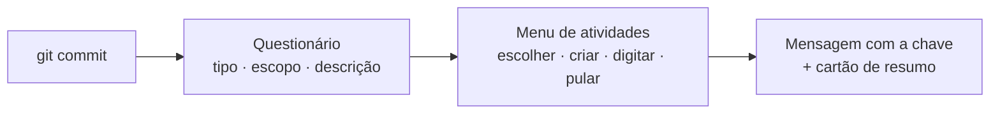
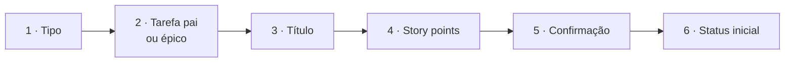

# 📘 Guia de uso

Tudo o que você precisa para usar o `jira-commit` no dia a dia. Para a lista completa de
opções do `.jira-commit.json`, veja a [referência de configuração](configuracao.md).

| Parte | Seções |
| --- | --- |
| **🚀 Começar** | [1. O que a CLI faz](#1-o-que-a-cli-faz) · [2. Pré-requisitos](#2-pré-requisitos) · [3. Instalação](#3-instalação) · [4. Login](#4-login) · [5. Configurar o repositório](#5-configurar-o-repositório) |
| **⌨️ Dia a dia** | [6. Commitando](#6-commitando) · [7. Questionário do commit](#7-questionário-do-commit) · [8. Menu de atividades](#8-menu-de-atividades) · [9. Criar atividade](#9-criar-atividade) · [10. Comentar e listar](#10-comentar-e-listar) |
| **✨ Recursos** | [11. Sugestões por IA](#11-sugestões-por-ia) · [12. Idioma](#12-idioma) · [13. Atalhos e automações](#13-atalhos-e-automações) |
| **🩺 Ajuda** | [14. Quando o menu não aparece](#14-quando-o-menu-não-aparece) · [15. Problemas comuns](#15-problemas-comuns) · [16. Perguntas frequentes](#16-perguntas-frequentes) |

---

# 🚀 Começar

> [!TIP]
> **Em resumo:** instale a CLI no projeto, rode `login` uma vez por máquina e `init` uma vez por
> repositório. Depois disso, é só commitar pelo terminal.

## 1. O que a CLI faz

Na hora do `git commit`, o `jira-commit`:

1. **Monta a mensagem**, se ela ainda não existe: pergunta tipo, escopo e descrição, com os
   tipos e escopos do projeto.
2. **Liga o commit a uma atividade do Jira**: mostra as suas atividades num menu e coloca a
   chave escolhida na mensagem.

```text
feat(home): adiciona card de benefício
        ↓
feat(home): LOJA-2411 adiciona card de benefício
```

Se a atividade ainda não existe, você **cria na hora**, inclusive como **subtarefa**. Ela já
sai com título, descrição, responsável, sprint e status. Também dá para **comentar** na
atividade sem abrir o Jira.

> [!NOTE]
> O `jira-commit` não faz push e só muda o status de uma atividade quando você **cria** uma e
> escolhe o status inicial.

## 2. Pré-requisitos

| | |
| --- | --- |
| **Node.js** | 22 ou mais novo. Confira com `node -v` |
| **Git** | Qualquer versão recente. No Windows funciona no Git Bash, no PowerShell e no terminal do VS Code |
| **Jira** | **Cloud** (`*.atlassian.net`) ou **Server / Data Center** 8.4+, com acesso ao projeto |
| **Token** | **Cloud:** API token, gerado em [id.atlassian.com](https://id.atlassian.com/manage-profile/security/api-tokens). **Server/DC:** token pessoal (PAT), criado no seu perfil do Jira |

## 3. Instalação

A CLI é publicada no npm como [`jira-commit-cli`](https://www.npmjs.com/package/jira-commit-cli).
Escolha um dos jeitos abaixo.

### No projeto (recomendado)

```bash
npm i -D jira-commit-cli
```

A CLI entra no `package.json`, e qualquer pessoa que rodar `npm install` fica com ela.

- **Versão fixa:** `npm i -D jira-commit-cli@0.4.0`. Sem versão, o npm instala a mais recente.
- **Atualizar:** `npm update jira-commit-cli`, ou `npm i -D jira-commit-cli@latest`.

### Só na sua máquina, sem mexer no `package.json`

```bash
npm i --no-save jira-commit-cli                    # do npm
npm i --no-save ../caminho/para/jira-commit-cli    # de uma pasta local
```

O próximo `npm install` remove o pacote, e aí o menu some do commit até você instalar de
novo. O `init` oferece pôr a CLI no `package.json` para evitar isso.

### Global: para projetos sem Node ou para todos os seus repositórios

```bash
npm i -g jira-commit-cli
jira-commit init      # o comando fica disponível em qualquer pasta, sem o npx
```

A máquina precisa ter Node; o projeto (Python, Java, Go…) não. O hook procura primeiro a CLI
do projeto e depois a global.

> [!WARNING]
> **Sempre use `npx --no-install jira-commit`** (com a instalação no projeto). Existe um pacote
> público **diferente** chamado `jira-commit` no npm. Sem o `--no-install`, o npx ofereceria
> baixar esse outro pacote, que pediria as suas credenciais do Jira.

Confira se deu certo: `npx --no-install jira-commit` deve mostrar a ajuda com os comandos.

## 4. Login

Uma vez por máquina:

```bash
npx --no-install jira-commit login
```

O `login` descobre sozinho se o Jira é Cloud ou Server e pede as credenciais certas:

| Pergunta | Jira Cloud | Jira Server / Data Center |
| --- | --- | --- |
| URL do Jira | `https://suaempresa.atlassian.net` | `https://jira.suaempresa.com.br` |
| E-mail | `voce@empresa.com` | *(não pergunta)* |
| Token (fica mascarado) | API token | Token pessoal: seu perfil → **Tokens de acesso pessoal** |

Ele testa a conexão e mostra `✔ Conectado como <seu nome>`. **Só então** o token é salvo.

**Mais de um Jira** (ex.: um por cliente): rode o `login` de novo para cada um. O primeiro
vira o padrão, e cada repositório aponta para o seu pelo campo `jiraUrl`, que o `init` preenche.

> [!CAUTION]
> As credenciais ficam em `~/.config/jira-commit/credentials.json`, em texto puro. No Linux e
> no macOS o arquivo é legível só pelo seu usuário. No Windows, fica protegido só pela pasta do
> seu perfil. **Nunca commite esse arquivo.**

## 5. Configurar o repositório

Uma vez por repositório:

```bash
npx --no-install jira-commit init
```

Pode rodar de novo quando quiser: ele só pergunta o que ainda falta. Em ordem, o `init`:

### a) Cria o `.jira-commit.json`

| Pergunta | O que responder |
| --- | --- |
| Chave do projeto | O prefixo das atividades. Ex.: `LOJA` para `LOJA-2410` |
| Qual Jira | Só aparece se você fez login em mais de um |
| Tipo das atividades que você criar | O tipo usado quando a atividade criada pela CLI **não** é subtarefa. Escolha na lista, que vem do seu Jira. Ex.: `Tarefa`, `Mobile` |
| Prefixo do título | Padrão `{product} \| <Tipo>: ` ([veja como funciona](#prefixo-do-título)) |
| Formato da mensagem | Em projetos com commitlint, aceite `{prefix}{key} {subject}` |

**Commite esse arquivo**: ele é a configuração do time para o repositório.

### b) Liga o questionário do commit

- Se o projeto tem um **`.cz-config.js`**, oferece importar os tipos, os escopos e o limite de
  caracteres dele.
- Senão, oferece os **tipos padrão da CLI** (os do Conventional Commits mais `patch`, `wip` e
  `merge`), sem escopos.
- Se você recusar, ele grava `"commit": false` e não pergunta de novo.

### c) Prepara o projeto para o time

Só em projetos com `package.json`. Cada item é perguntado antes e só aparece se estiver faltando:

| Item | Por quê |
| --- | --- |
| **jira-commit no `package.json`** | Quem rodar `npm install` já fica com a CLI |
| **Husky** | O hook vai para o repositório (`.husky/`) e vale para todo mundo. O script `"prepare": "husky"` ativa o hook a cada `npm install` |

O gerenciador é detectado pelo lock (`pnpm-lock.yaml` → pnpm, `yarn.lock` → yarn, senão npm). Se
a instalação falhar, o `init` mostra o comando para rodar à mão e segue.

> [!NOTE]
> O `init` **não** roda o `husky init`, que criaria um `pre-commit` com `npm test`. Projetos com
> o Husky 4 (configurado dentro do `package.json`) não são alterados.

### d) Instala o hook

| Projeto | Onde fica o hook | Vale para o time? |
| --- | --- | --- |
| Com Husky | `.husky/prepare-commit-msg` | ✔ Sim |
| Sem `package.json` | `.githooks/` + `git config core.hooksPath .githooks` (o `init` oferece) | ✔ Sim, depois que cada pessoa roda o `init` uma vez |
| Outros casos | `.git/hooks/prepare-commit-msg` | ✖ Só na sua máquina |

- Se o hook já existe, a linha do jira-commit é **acrescentada no fim**, sem apagar nada.
  Rodar o `init` de novo não duplica a linha, e um hook de versão antiga é atualizado.
- Se o hook tem o **commitizen** (`cz --hook`), o `init` oferece tirá-lo, para as perguntas
  não aparecerem duas vezes.

### e) Cria o `npm run commit`

O script `git commit --no-edit` faz as perguntas e commita **sem abrir o editor** no fim. Se já
existir um script `commit` (ex.: `git-cz`), o `init` pergunta antes de trocar.

Depois do `init`, **commite** o `.jira-commit.json`, o `package.json`, o lock e a pasta `.husky`
(ou `.githooks`).

---

# ⌨️ Dia a dia

> [!TIP]
> **Em resumo:** `git add`, `npm run commit`, responda tipo, escopo e descrição, e escolha a
> atividade. Digite para buscar, **Esc** para voltar, **Ctrl+C** para desistir.

## 6. Commitando

Sempre **pelo terminal**:

```bash
git add .
npm run commit                       # questionário completo, sem editor no fim
git commit                           # questionário completo, abre o editor no fim
git commit -m "feat(home): ..."      # pula o questionário, vai direto ao menu
```

O commit passa por três etapas:



### Teclas

| Tecla | Onde | O que faz |
| --- | --- | --- |
| `↑` `↓` | Listas | Navega. A lista para no fim, sem dar a volta |
| `Enter` | Qualquer pergunta | Escolhe ou confirma |
| *digitar* | Listas com busca | Filtra a lista (sem ligar para acento ou maiúscula) |
| `Esc` | Qualquer pergunta | **Volta ao passo anterior**, mantendo o que já foi respondido |
| `Ctrl+C` | Qualquer pergunta | Cancela o commit. Nada é commitado, e o stage fica como estava |
| `\|` | Corpo e comentário | Quebra linha ou parágrafo |

## 7. Questionário do commit

Num commit sem mensagem (`npm run commit` ou `git commit` sem `-m`), a CLI pergunta:

```text
◆ Tipo · digite para filtrar fe
❯ feat      Uma nova funcionalidade
◆ Escopo · digite para filtrar sign
❯ sign-in
  sign-up
◆ Descrição · feat(sign-up): …
cria a tela de confirmação de e-mail
```

| Pergunta | Detalhes |
| --- | --- |
| **Tipo** | Cada tipo tem a sua cor. Digite parte do nome ou da descrição para filtrar |
| **Escopo** | Só aparece se o projeto tiver escopos. Tem a opção "— sem escopo" |
| **Descrição** | O que vem depois de `tipo(escopo):`. O limite de tamanho já desconta o espaço da chave do Jira. Com a IA ligada, já vem preenchida |

Corpo e BREAKING CHANGE **não** são perguntados em todo commit: quando precisar, use a ação
**¶ Adicionar corpo / BREAKING CHANGE** no menu de atividades.

O resultado:

```text
feat(sign-up): LOJA-2410 cria a tela de confirmação de e-mail
```

### Commitlint com a mesma lista

Para os tipos e escopos ficarem num lugar só, faça o `commitlint.config.cjs` ler o
`.jira-commit.json`:

```js
const { commit } = require('./.jira-commit.json');

module.exports = {
  extends: ['@commitlint/config-conventional'],
  rules: {
    'type-enum': [2, 'always', commit.types.map((t) => t.value ?? t)],
    'scope-enum': [2, 'always', commit.scopes],
    'header-max-length': [2, 'always', commit.headerMaxLength],
    'subject-case': [0], // a descrição começa com a chave em maiúsculas (LOJA-12 …)
  },
};
```

> [!IMPORTANT]
>
> - O `subject-case` precisa ficar **desligado**: a descrição começa com `LOJA-12`, e a regra
>   padrão rejeita isso.
> - Use `"format": "{prefix}{key} {subject}"`. Com `{key}: {message}` a mensagem começaria pela
>   chave, e o commitlint exige que ela comece pelo tipo.
> - Os tipos `patch`, `wip` e `merge` só passam no commitlint com o `type-enum` acima.

### Vindo do commitizen

O `init` faz a migração: importa os tipos e escopos do `.cz-config.js`, tira o `cz --hook` do
hook e troca o script `commit`. Depois de conferir que está tudo certo, dá para apagar o
`.cz-config.js`, o bloco `config.commitizen` do `package.json` e os pacotes
(`npm uninstall commitizen cz-customizable`).

## 8. Menu de atividades

O menu tem **ações** no topo e as **suas atividades** em árvore embaixo:

```text
◆ jira-commit   LOJA  ⎇ develop
│ feat(home): adiciona card de benefício  · esc volta ao passo anterior

◆ Qual atividade é esse commit? · digite para buscar
  + Criar nova atividade
  ⋯ Ver outros status
  ✎ Digitar a chave
  ¶ Adicionar corpo / BREAKING CHANGE
  ❝ Comentar na atividade
  ↷ Pular
── suas atividades (31) ─────────────────
❯ LOJA-2375  LOJA DO BAIRRO | Mobile - Benefícios: Criar tela de…   ● Em andamento
  ├─ LOJA-2415  LOJA DO BAIRRO | Mobile: Criar testes E2E com M…   ● Tarefas pendentes
  └─ LOJA-2413  LOJA DO BAIRRO | Mobile: Exibir os estados de c…   ● Tarefas pendentes
  LOJA-2416  LOJA DO BAIRRO | Tema Mobile - Tirar o dark mode d…   ● Tarefas pendentes

  LOJA DO BAIRRO | Mobile - Benefícios: Criar tela de benefícios quando…  ·  Em andamento
  ↑↓ navegar  ·  ⏎ escolher  ·  esc voltar
```

### Como ler a lista

| O que você vê | Significado |
| --- | --- |
| `├─` / `└─` | Subtarefa da tarefa de cima |
| Linha apagada | Tarefa pai fora do filtro de status: só dá contexto, não dá para escolher |
| `●` azul | Status "a fazer" |
| `●` amarelo | Status "em andamento" (inclui TESTANDO, PARA CORRIGIR etc.) |
| `●` verde | Status concluído |
| Texto apagado antes do `\|` | O produto ("LOJA DO BAIRRO"), para destacar o nome da atividade |
| Linha embaixo da lista | O título completo da atividade destacada, que na lista aparece cortado |

### Onde o cursor começa

Sempre numa **atividade**, nunca numa ação (um Enter sem querer não cria nada):

1. na atividade com a **chave da branch** (ex.: `feature/LOJA-2410-header`), cuja família vai
   para o topo;
2. senão, na **última atividade usada nesta branch** (marcada com **★ última usada**);
3. senão, na primeira da lista.

### Quais atividades aparecem

Por padrão, só as **suas** (`assignee = você`), nos status do campo `statuses`. Para ver as
outras, use **⋯ Ver outros status**, e para voltar, **← Voltar aos status padrão** (ou Esc).

### Buscar pelo título

Digite direto no menu. A busca acontece em dois lugares:

```text
◆ Qual atividade é esse commit? · digite para buscar login
── suas atividades (1) ──────────────────
❯ LOJA-2371  LOJA DO BAIRRO | Mobile - Tela de Login: Revisar f…   ● Em andamento
── outras no projeto (6) ────────────────
  LOJA-1801  Mobile - Login | Criar fluxo de Login, incluindo tr…   ● Tarefas pendentes
── ações ────────────────────────────────
  + Criar nova atividade
```

| Grupo | Como funciona |
| --- | --- |
| **Suas atividades** | Filtradas **na hora**, a cada tecla. Vale qualquer parte do título ou da chave. Com várias palavras, todas precisam aparecer (`card benef` acha "Criar o componente de card de benefício") |
| **Outras no projeto** | Quando você para de digitar, a CLI busca no Jira as atividades **abertas** do projeto inteiro, de qualquer pessoa. Um número (`2375`) ou a chave acha a atividade direto, mesmo concluída |

> [!NOTE]
> Na busca do projeto, quem procura é o Jira, e ele **considera os acentos**: `benef` e
> `benefício` acham, `beneficio` não. Na dúvida, digite só o começo da palavra. A pontuação
> separa palavras: `README.md` procura "README" e "md".

### Ações

| Ação | O que acontece |
| --- | --- |
| **+ Criar nova atividade** | Cria no Jira e já vincula ao commit ([seção 9](#9-criar-atividade)) |
| **⋯ Ver outros status** | Mostra todas as suas atividades abertas |
| **✎ Digitar a chave** | Para uma atividade que não é sua ou não está na lista. A CLI confere se ela existe |
| **¶ Adicionar corpo / BREAKING CHANGE** | Pergunta o corpo do commit e o BREAKING CHANGE (os dois opcionais) e volta ao menu |
| **❝ Comentar na atividade** | Escreve um comentário que é publicado na atividade que você escolher em seguida. Se falhar, só avisa |
| **↷ Pular** | Commita sem chave do Jira |

### O resultado

No fim aparece um cartão com o que aconteceu e o link da atividade:

```text
╭─ ✔ Commit vinculado ───────────────────────────────╮
│  LOJA-2410   Tela de login                          │
│                                                     │
│ fix(login): LOJA-2410 corrige foco do campo         │
│ ↗ https://suaempresa.atlassian.net/browse/LOJA-2410 │
╰─────────────────────────────────────────────────────╯
```

## 9. Criar atividade

Escolha **+ Criar nova atividade** no menu. São até seis perguntas, e o **Esc** volta uma de
cada vez:



### 1. Tipo

```text
◆ Que tipo de atividade?
❯ ↳ Subtarefa
  ▣ Mobile
  Fica embaixo de uma tarefa existente e herda sprint, labels e componentes
```

### 2. Tarefa pai ou épico

**Subtarefa** → escolha a tarefa pai. A **última tarefa pai usada neste repositório** já vem
selecionada:

```text
◆ Subtarefa de qual tarefa?
  ✎ Digitar a chave da tarefa pai
── tarefas (12) ─────────────────────────
❯ LOJA-2375  LOJA DO BAIRRO | Mobile - Benefícios: ...  ★ última usada
  LOJA-2373  LOJA DO BAIRRO | Mobile - Tela Inicial: ...
```

**Tarefa** → escolha o épico, com busca por digitação. A sugestão é o último épico usado neste
repositório (ou, na primeira vez, o que mais aparece nas suas atividades):

```text
◆ Épico da tarefa · digite para buscar
  — sem épico
── épicos abertos (59) ──────────────────
❯ LOJA-232   MOBILE  ★ mais usado
  LOJA-2392  PERMISSÃO
```

Se o projeto não tiver épicos abertos, essa pergunta não aparece.

### 3. Título

O campo já vem **preenchido e editável**: prefixo + texto do commit (ou a sugestão da IA). O
nome sempre começa com **maiúscula** depois do prefixo: `atualiza link` vira
"LOJA DO BAIRRO | Mobile: Atualiza link".

```text
◆ Título · sugerido pela IA
LOJA DO BAIRRO | Mobile: Criar card de benefício na Home▌
```

<a id="prefixo-do-título"></a>

> [!NOTE]
> **Prefixo do título.** Vem do `summaryPrefix`. O `{product}` vira o trecho do título da tarefa
> pai antes do ` | `:
>
> | Tarefa pai | `summaryPrefix` | Prefixo |
> |---|---|---|
> | `LOJA DO BAIRRO \| Mobile - Benefícios: Criar…` | `{product} \| Mobile: ` | `LOJA DO BAIRRO \| Mobile: ` |
> | `Criar fluxo de login` (sem ` \| `) | `{product} \| Mobile: ` | *(sem prefixo)* |
>
> Numa **tarefa sem pai**, o `{product}` é o produto que mais aparece nas suas atividades. O
> separador ` | ` pode ser trocado no campo `productSeparator`.

### 4. Story points

Opcional: Enter direto deixa sem estimativa. Só aparece se o tipo tiver o campo de estimativa
na tela de criação do Jira. A escala (padrão 1, 2, 3, 5, 8, 13) vem do `storyPointsScale`, e
`"storyPoints": false` desliga a pergunta.

### 5. Confirmação

```text
◆ Criar Mobile em LOJA no épico LOJA-232 na Sprint 62? (Y/n)
✔ LOJA-2423 criada no Jira
✔ LOJA-2423 na Sprint 62
```

Responder **"não" volta ao menu**, sem criar nada.

### 6. Status inicial

```text
◆ Status de LOJA-2423
❯ ● Manter em Tarefas pendentes
  → Em andamento
  → TESTANDO
```

As opções são as transições que o workflow permite. A partir daqui a atividade **já existe** no
Jira, então o Esc não volta mais.

### O que vai para o Jira

| Campo | Valor |
| --- | --- |
| **Título** | O que você confirmou no passo 3 |
| **Tipo** | Subtarefa (descoberta automaticamente) ou o `issueType` |
| **Pai** | A tarefa escolhida (subtarefa) ou o épico (tarefa) |
| **Responsável** | Você |
| **Descrição** | Corpo do commit + lista **Arquivos alterados** do stage |
| **Labels e componentes** | Copiados da tarefa pai |
| **Sprint** | Tarefa: a sprint ativa do quadro (sem sprint ativa, fica no backlog). Subtarefa: a do pai |
| **Story points** | O que você escolheu (ou vazio) |

> [!NOTE]
> Se mover para a sprint ou mudar o status falhar, a atividade **continua criada** e o commit
> segue. Só um erro na criação em si cancela o commit.

## 10. Comentar e listar

### Comentar numa atividade

Junto com o commit, use a ação **❝ Comentar na atividade** do menu. Fora do commit:

```bash
npx --no-install jira-commit comment                                  # escolhe na lista e escreve
npx --no-install jira-commit comment LOJA-2410                        # só pergunta o texto
npx --no-install jira-commit comment 2410 "subi o ajuste em develop"  # direto, sem perguntas
```

- **Chave:** `LOJA-2410` ou só o número, `2410`. Sem chave, abre a lista com a mesma busca do
  menu do commit.
- **Texto:** sem ele, a CLI pergunta. Use `|` para quebrar parágrafo.
- **Esc** volta do texto para a lista; na lista, cancela.

### Listar as suas atividades

```bash
npx --no-install jira-commit list                        # status padrão (statuses)
npx --no-install jira-commit list --todos                # todas as suas abertas
npx --no-install jira-commit list --status "em andamento" # um status, como aparece na tela
```

O `--status` não diferencia maiúsculas. Se o nome não existir, a CLI mostra os status válidos.

---

# ✨ Recursos

## 11. Sugestões por IA

Opcional e **desligada por padrão**. Ligada, a IA ajuda em dois lugares:

| Onde | O que ela faz |
| --- | --- |
| **Descrição do commit** | Lê o diff do stage, a lista de arquivos e as ~10 últimas descrições do repositório, para seguir o estilo do time. O pedido sai assim que o commit começa, enquanto você escolhe tipo e escopo |
| **Título da atividade** | Lê o diff, os arquivos, o commit e a tarefa pai, e sugere um título curto: no infinitivo em português ("Criar card de benefício na Home") ou no imperativo em inglês ("Add benefit card to home") |

As sugestões chegam **preenchidas e editáveis**. Desligada, ou se a IA falhar ou demorar mais
de 8 segundos, tudo funciona como antes, só sem sugestão.

**Como ligar:** são dois passos, e a IA só funciona com os dois.

1. No `.jira-commit.json` do repositório, `"ai": true`.
2. Na sua máquina, a variável `ANTHROPIC_API_KEY`:

```bash
# Git Bash / Linux / macOS (no ~/.bashrc para ficar permanente)
export ANTHROPIC_API_KEY="sk-ant-..."
```

```powershell
# PowerShell (permanente para o seu usuário; abra um terminal novo depois)
[Environment]::SetEnvironmentVariable("ANTHROPIC_API_KEY", "sk-ant-...", "User")
```

**Como ajustar** (no `.jira-commit.json`):

| Campo | Efeito |
| --- | --- |
| `"ai": true` | Liga a IA neste repositório. Sem ele, a IA fica desligada mesmo com a chave definida |
| `"aiModel": "claude-haiku-5-5"` | Troca o modelo. O padrão é `claude-opus-5-5` com esforço baixo; o Haiku é mais rápido e mais barato |
| `"aiInstructions": "…"` | Orientação do projeto, somada às instruções da CLI. Ex.: `"Use os termos do domínio bancário"` |

> [!WARNING]
> **Privacidade:** com a IA ligada, o diff do commit é enviado para a API da Anthropic, inclusive
> um segredo que entre no stage por engano. Siga a
> política da empresa sobre envio de código para serviços externos.

## 12. Idioma

A CLI fala **português** e **inglês**: menus, mensagens, erros, a ajuda e as sugestões da IA.
O idioma é escolhido nesta ordem:

| Prioridade | Fonte | Vale para |
| --- | --- | --- |
| 1 | `"language": "pt"` ou `"en"` no `.jira-commit.json` | O time, naquele repositório |
| 2 | Variável `JIRA_COMMIT_LANG` (`pt` ou `en`) | Você |
| 3 | Idioma do sistema: `pt-*` → português, o resto → inglês | Você |

```bash
JIRA_COMMIT_LANG=en npx --no-install jira-commit --help          # Git Bash
```

```powershell
$env:JIRA_COMMIT_LANG = "en"; npx --no-install jira-commit --help  # PowerShell
```

## 13. Atalhos e automações

### Pular o hook uma vez

Útil em rebase, scripts e CI: o hook não pergunta nada nem mexe na mensagem.

```bash
JIRA_COMMIT_SKIP=1 git commit -m "wip"                                          # Git Bash
```

```powershell
$env:JIRA_COMMIT_SKIP = "1"; git commit -m "wip"; Remove-Item Env:JIRA_COMMIT_SKIP  # PowerShell
```

### Vincular direto pela branch

Com `"autoLinkBranch": true` no `.jira-commit.json` e uma chave no nome da branch (ex.:
`feature/LOJA-2410-login`), o commit é vinculado direto a ela, **sem abrir o menu**. Sem chave
na branch, o menu aparece como sempre.

---

# 🩺 Ajuda

## 14. Quando o menu não aparece

Na maioria das vezes, é de propósito:

| Situação | O que acontece |
| --- | --- |
| A mensagem já tem a chave (ex.: `-m "... LOJA-12 ..."`) | Nada: ela já está ligada |
| `git commit --amend`, merge ou squash | Nada |
| `JIRA_COMMIT_SKIP=1` | Nada |
| Commit pelo **botão** do editor (VS Code, GitHub Desktop…) | O hook é pulado: não há terminal para o menu |
| `autoLinkBranch` com chave na branch | Vincula direto, sem menu |
| CLI não instalada (nem no projeto nem global) | O commit **segue sem o menu** e avisa `jira-commit: CLI não encontrada` |
| Jira fora do ar ou sem rede | Avisa e pede a chave à mão (vazio = pular) |
| Erro ao **criar** a atividade | Mostra o erro e **cancela o commit**. Rode o commit de novo |

## 15. Problemas comuns

### Comece pelo `doctor`

```bash
npx --no-install jira-commit doctor
```

```text
✔ Node               v22.12.0
✔ Repositório git    C:/projetos/app
✔ .jira-commit.json  projeto LOJA
✔ Login no Jira      https://suaempresa.atlassian.net (Cloud)
✖ Conexão            token inválido ou expirado
                     → Rode: jira-commit login
✔ Hook               .husky/prepare-commit-msg
✖ Pasta dos hooks    o Husky não está ativo neste clone
                     → Rode: npm install (o script "prepare" ativa o Husky)
✔ CLI para o hook    no node_modules do projeto

 ✖ 2 problema(s) para corrigir
```

Ele confere o Node, o `.jira-commit.json`, o login, a conexão, o projeto, o hook (instalado,
atualizado e na pasta certa), se o hook acha a CLI, o Husky e a IA. Sai com código 1 quando
há algum ✖, então também serve em scripts.

### Mensagens de erro

<details>
<summary><b>Credenciais do Jira não encontradas</b></summary>

Rode o `login`. Se você usa variáveis de ambiente, confira se `JIRA_BASE_URL` e
`JIRA_API_TOKEN` (e `JIRA_EMAIL`, no Cloud) estão definidas.
</details>

<details>
<summary><b>Jira respondeu 401</b></summary>

O token expirou ou foi revogado, ou o e-mail está errado. Gere um token novo e rode o `login`.
</details>

<details>
<summary><b>Arquivo .jira-commit.json não encontrado</b></summary>

O repositório ainda não foi configurado. Rode o `init`, ou faça `git pull` para pegar o arquivo
do time.
</details>

<details>
<summary><b>.jira-commit.json tem N problema(s)</b></summary>

A CLI aponta cada campo errado, por exemplo `maxResults deve ser número inteiro`. Corrija o
arquivo. Com o `$schema` que o `init` grava, o editor já sublinha o erro.
</details>

<details>
<summary><b>Status "X" não existe em LOJA</b></summary>

Algum nome em `statuses` (ou no `--status`) está diferente do Jira. Copie o nome exatamente
como aparece na lista do erro.
</details>

<details>
<summary><b>jira-commit: CLI não encontrada / not found</b></summary>

O hook não achou a CLI nem no projeto nem global. O commit foi feito, só que sem a chave.
Instale a CLI ([seção 3](#3-instalação)).
</details>

<details>
<summary><b>npx canceled due to missing packages</b></summary>

O hook é de uma versão antiga, que cancelava o commit sem a CLI. Rode o `init` de novo: ele
troca o hook pelo bloco novo.
</details>

<details>
<summary><b>O commitlint rejeitou a mensagem</b></summary>

Confira se o `format` é `{prefix}{key} {subject}` e se o `subject-case` está desligado
([seção 7](#commitlint-com-a-mesma-lista)).
</details>

<details>
<summary><b>Erro ao criar: tipo de issue inválido</b></summary>

O `issueType` não existe no projeto. O `doctor` mostra os tipos disponíveis.
</details>

### Outros sintomas

| Sintoma | O que fazer |
| --- | --- |
| **O menu não aparece** | Commitou pelo botão do editor? Use o terminal. Confira também a [seção 14](#14-quando-o-menu-não-aparece) e rode o `doctor` |
| **Falta uma atividade na lista** | A lista mostra só as **suas**, nos `statuses`. Use **⋯ Ver outros status**, digite para buscar no projeto, ou **✎ Digitar a chave**. O limite é `maxResults` (padrão 20) |
| **O terminal parou de responder** | Ctrl+C cancela o commit sem mexer em nada. Se acontecer de novo, mande a sequência de teclas para quem mantém a CLI |
| **As cores não aparecem** | O terminal não é interativo, ou a variável `NO_COLOR` está definida. É só visual |
| **O Esc demora um pouco** | É normal: o terminal espera ~0,5 s para saber se o Esc é o começo de uma seta |

## 16. Perguntas frequentes

<details>
<summary><b>Preciso fazer login em cada repositório?</b></summary>

Não. O login vale para a máquina inteira. O `init` é que é feito uma vez por repositório.
</details>

<details>
<summary><b>O jira-commit muda o status das minhas atividades?</b></summary>

Só quando você **cria** uma atividade e escolhe o status inicial. As atividades existentes não
mudam.
</details>

<details>
<summary><b>Posso usar sem commitizen? E sem Conventional Commits?</b></summary>

Pode, e é o recomendado: o questionário próprio substitui o commitizen. Sem a seção `commit`,
um commit sem `-m` pede a mensagem inteira numa pergunta só, e o formato padrão
`{key}: {message}` gera `LOJA-12: adiciona card`.
</details>

<details>
<summary><b>Como adiciono um tipo ou escopo?</b></summary>

Edite a seção `commit` do `.jira-commit.json` (`types` ou `scopes`) e commite. Se o commitlint
lê o mesmo arquivo ([seção 7](#commitlint-com-a-mesma-lista)), ele aceita o valor novo na hora.
</details>

<details>
<summary><b>Onde fica a "última atividade usada"?</b></summary>

Em `~/.config/jira-commit/state.json`, separada por repositório e por branch. É só da sua
máquina e não vai para o git.
</details>

<details>
<summary><b>Dá para usar com outro projeto do Jira, ou outro Jira?</b></summary>

Dá. Cada repositório tem o seu `.jira-commit.json` com `projectKey`, `issueType` e `statuses`
próprios, e o `jiraUrl` aponta para o Jira certo quando você usa mais de um.
</details>
